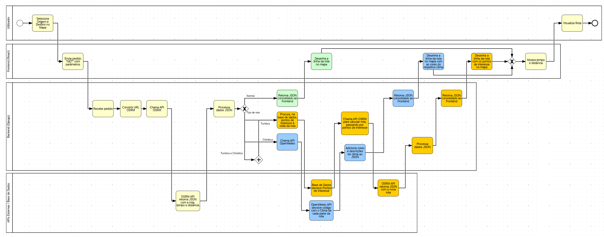
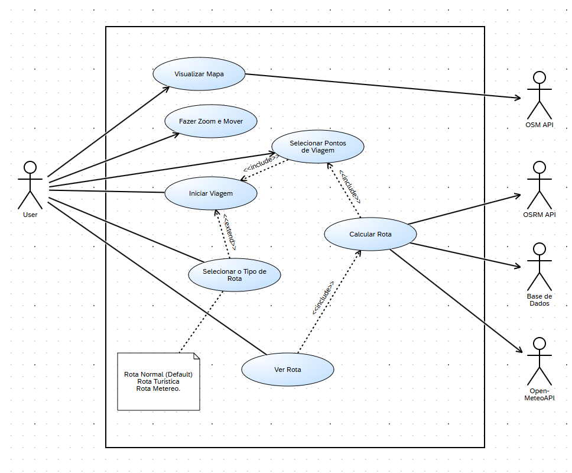
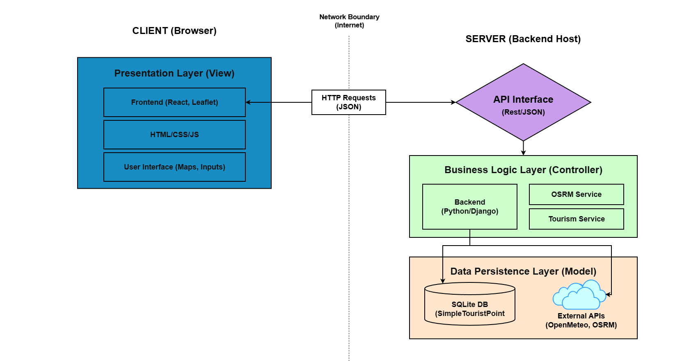
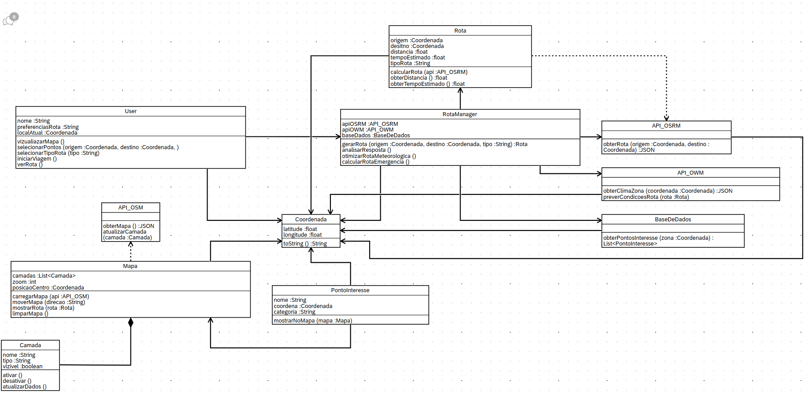
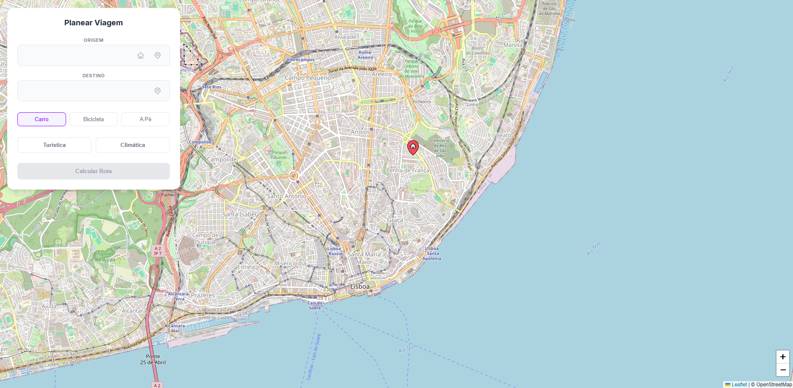
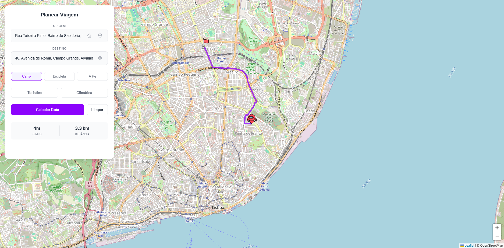
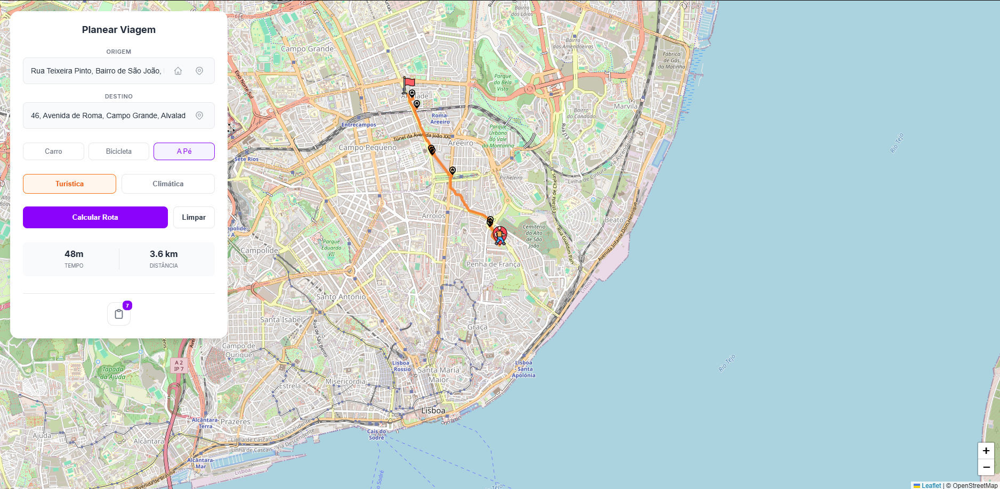
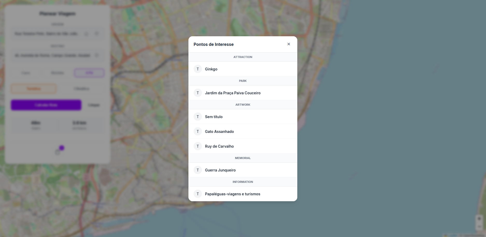
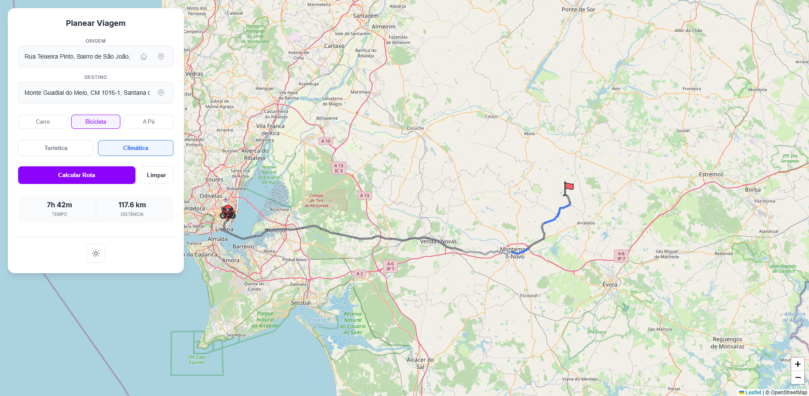
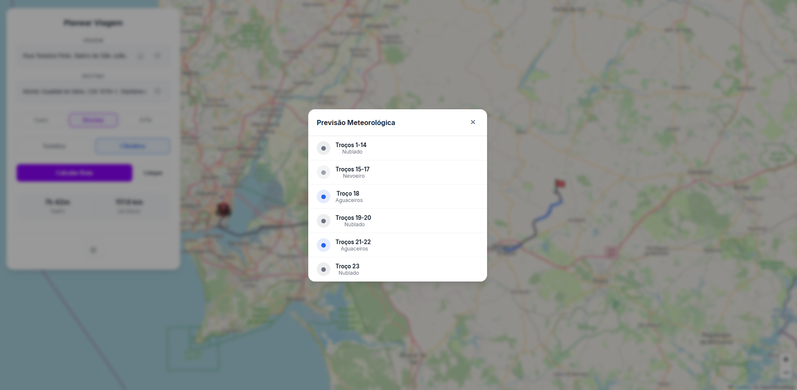

# BetterMaps
O objetivo deste projeto é desenvolver uma aplicação interativa que permita ao utilizador explorar um mapa baseado nos dados do OpenStreetMap (OSM), traçar rotas entre pontos de interesse e obter informações relevantes sobre o trajeto e a área circundante.

## Objetivos Gerais

- Fornecer uma interface de mapa interativa e intuitiva.
- Permitir a seleção de origem e destino diretamente no mapa.
- Calcular e apresentar rotas com base na **API OSRM (Open Source Routing Machine)**.
- Exibir informações detalhadas da rota (distância, tempo estimado, tipo de percurso).
- Integrar funcionalidades como:
  - **Rotas Normais** (cálculo de rotas padrão entre origem e destino);
  - **Rotas Turísticas** (pontos de interesse e locais culturais ao longo do trajeto);
  - **Rotas Climáticas** (condições meteorológicas locais ao longo da rota com segmentos coloridos).

## BPMN


## Use Case Diagram


## Arquitetura de Sistema


## Decisões Tecnológicas

| Área | Decisão | Justificação |
|------|----------|--------------|
| **Mapa Base** | OpenStreetMap (OSM) | Fonte aberta e flexível de dados geográficos. |
| **Cálculo de Rotas** | OSRM API | Rápida, gratuita e de fácil integração via REST/JSON. |
| **Frontend** | HTML, CSS, JavaScript (React e Leaflet) | Permite construir uma aplicação leve e responsiva com controlo total do mapa. |
| **Backend** | Python (Django) | Uma framework robusta que conjuga bem com React. |
| **APIs Externas** | Open-Meteo, Nominatim, OSRM | Integração modular e extensível com APIs gratuitas e de código aberto. |
| **Gestão de Projeto** | GitHub + Scrum (Trello) | Gestão iterativa com controlo de progresso por sprints. |
| **Armazenamento** | SQLite (Django) | Armazena histórico de rotas e preferências offline. |

## Desenho do Software

O sistema é composto por **módulos principais** que interagem entre si:

### 1. Camada de Apresentação (Frontend)
- Interface gráfica interativa baseada em **Leaflet**.
- Controlo de zoom, pan e seleção de pontos.
- Painel lateral para exibir opções de menu e detalhes da rota.

### 2. Camada Lógica (Backend)
- **OSRM Service** → Comunicação com OSRM para cálculo de trajetos.
- **Weather Service** → Integração com Open-Meteo API para previsões ao longo da rota.
- **Tourism Service** → Gestão e busca de pontos de interesse turísticos.
- **Geocoding Service** → Integração com Nominatim para conversão endereço ↔ coordenadas.

### 3. Camada de Dados
- **Base de Dados Local** → Armazenamento de pontos de interesse e histórico.
- **APIs Externas** → Fornecimento de dados em tempo real.

### Diagrama de Classes (Resumo)


---

## Atributos de Qualidade Alvo

Este projeto foi desenhado tendo em conta quatro pilares fundamentais de qualidade de software. Abaixo descreve-se a justificação e os requisitos para cada atributo.

### A. Interoperabilidade (Interoperability)
* **Justificação:** O sistema é fundamentalmente um integrador que comunica com múltiplos sistemas externos (OSRM, Open-Meteo, Nominatim).
* **Requisito:** O Backend deve ser capaz de normalizar as respostas JSON destas APIs diferentes num formato único e padrão para o Frontend consumir.

### B. Usabilidade (Usability)
* **Justificação:** O objetivo central é fornecer uma interface de mapa interativa e intuitiva.
* **Requisito:** A interface deve permitir "Zoom, Pan e Seleção" sem latência percetível na renderização gráfica. O sistema deve fornecer feedback visual imediato ao traçar rotas.

### C. Modificabilidade (Modularity/Maintainability)
* **Justificação:** O projeto divide-se em serviços claros para facilitar a manutenção e evolução.
* **Requisito:** A arquitetura deve permitir adicionar um novo serviço (ex: um futuro "EmergencyService") sem ter de reescrever o código dos serviços existentes, aproveitando o desacoplamento do Django.

### D. Performance (Time Behaviour)
* **Justificação:** O cálculo de rotas e a exibição de dados meteorológicos não podem bloquear a navegação no mapa.
* **Requisito:** O tempo de resposta entre o pedido de rota e a visualização deve ser otimizado, delegando o processamento pesado para as APIs externas.

---

## Implementação

### Funcionalidades Implementadas

#### 1. **Interface Interativa do Mapa** 
A aplicação frontend apresenta uma interface baseada em Leaflet.js com as seguintes capacidades:
- Visualização de mapa interativo com OpenStreetMap
- Controlo de zoom e pan sem latência percetível
- Seleção dinâmica de origem e destino no mapa
- Marcadores de localização do utilizador
- Painel lateral com informações de rota e opções de menu



#### 2. **Cálculo de Rotas Normais**
Implementado através do serviço OSRM:
- Cálculo de rota entre dois pontos (origem e destino)
- Suporte para múltiplos perfis de transporte: automóvel, bicicleta e a pé
- Retorno de informações detalhadas:
  - Distância total (em metros)
  - Tempo estimado (em segundos)



#### 3. **Rotas Turísticas**
Integração com pontos de interesse (POIs) locais:
- Deteção automática de pontos de interesse ao longo da rota
- Geração de desvios para locais culturais, históricos e turísticos
- Categorização de pontos (museus, monumentos, restaurantes, etc.)
- Armazenamento local de POIs em base de dados SQLite
- Dados importados de ficheiros CSV (portugal.csv, lisboa.csv)




#### 4. **Rotas Climáticas**
Análise de condições meteorológicas ao longo da rota:
- Integração com API Open-Meteo para dados meteorológicos em tempo real
- Processamento em lote (batch) de até 50 pontos por pedido para otimização
- Análise de condições climáticas em segmentos da rota
- Codificação visual por cores
- Exibição do tempo para cada segmento




#### 5. **Backend Django e Serviços**
Arquitetura modular com os seguintes componentes:

**Services Implementados:**
- **OSRM Service** (`osrm_service.py`): Gestão de rotas com suporte turístico e climático
- **Weather Service** (`weather_service.py`): Integração com Open-Meteo, processamento em batch
- **Tourism Service** (`tourism_service.py`): Busca local de POIs com otimização geoespacial
- **Geocoding Service** (`geocoding_service.py`): Conversão de coordenadas ↔ endereços via Nominatim
- **Config** (`config.py`): Configuração centralizada de URLs e servidores

**API Endpoints:**
- `POST /api/route/` - Cálculo de rota (normal, turística ou climática)
- `GET /api/geocode/` - Geocodificação de endereços
- `POST /api/weather/` - Dados meteorológicos batch

#### 6. **Gestão de Dados**
- Base de dados SQLite para armazenamento persistente
- Modelo `SimpleTouristPoint` para POIs com campos: lat, lng, name, category
- Comando de management customizado (`load_points.py`) para importação de CSV
- Migrations Django para versionamento de schema

#### 7. **Testes Automatizados**
- Testes de qualidade em backend (Django test framework)
- Testes de qualidade em frontend (Jest)
- Validação de atributos de qualidade (Interoperabilidade, Usabilidade, Modificabilidade, Performance)
- Taxa de sucesso: 100% (20 testes executados com sucesso)

### Componentes Frontend

**Principais componentes React:**
- `MapComponent.js` - Componente pai que coordena a interface
- `MapMarkers.js` - Gestão de marcadores no mapa
- `LocationMarker.js` - Marcador de localização do utilizador
- `RouteModal.js` - Modal para seleção de tipo de rota
- `SidePanel.js` - Painel lateral com informações
- `ZoomTracker.js` - Tracking de nível de zoom

**Hooks customizados:**
- `useMapIcons.js` - Gestão de ícones do mapa
- `useRouteData.js` - Lógica de obtenção de dados de rota
- `useUserLocation.js` - Localização do utilizador em tempo real

## Escalabilidade

### 1. Escalabilidade da Camada de Dados
* **Migração para PostgreSQL/PostGIS**: O sistema utiliza atualmente SQLite para o armazenamento de pontos de interesse (POIs) e histórico. Para suportar grandes volumes de dados geográficos e consultas espaciais complexas, a transição para PostgreSQL com PostGIS garantirá maior performance e integridade de dados.
* **Implementação de Caching**: Para reduzir a latência e a dependência excessiva de APIs externas (OSRM e Open-Meteo), pode ser integrada uma camada de cache como o **Redis** para armazenar rotas e previsões meteorológicas consultadas frequentemente.

### 2. Escalabilidade do Backend
* **Desacoplamento em Microserviços**: A separação lógica atual entre `OSRM Service`, `Weather Service` e `Tourism Service` permite que cada componente seja isolado num microserviço independente. Isto possibilita escalar individualmente o serviço com maior carga (ex: cálculo de rotas climáticas) sem afetar os restantes.

### 3. Escalabilidade de Infraestrutura e APIs
* **Self-hosting de Serviços Críticos**: Para eliminar limites de taxa (rate limits) e latência de rede, o sistema está preparado para migrar de APIs públicas para instâncias próprias de serviços como o **OSRM** ou o **Nominatim**, alojadas em hardware dedicado.
* **Escalabilidade Horizontal**: O backend em Django, atuando como controlador entre o cliente e os serviços, pode ser replicado em múltiplas instâncias atrás de um **Load Balancer**, permitindo gerir um elevado número de pedidos simultâneos.

---

## Relatório de Testes e Garantia de Qualidade (QA)

### Testes de Validação Comparativa

Para validar a precisão do motor de rotas **OSRM** utilizado no BetterMaps, foram realizados testes comparativos para garantir que as métricas de distância e tempo (ETA) são realistas quando comparadas com outras plataformas.

#### Tabela de Resultados Práticos

| Trajeto | Aplicação | Distância (km) | Tempo | Desvio (D: Distância \| T: Tempo) |
| :--- | :--- | :--- | :--- | :--- |
| **Urbano** | **BetterMaps** | 8.7km | 11min | - |
| (Alameda -> Museu Coches) | Google Maps | 10.6km | 26min | D: +21.8% \| T: +136.4% |
| | Waze | 10.9km | 28min | D: +25.3% \| T: +154.5% |
| | Bing Maps | 10.8km | 25min | D: +24.1% \| T: +127.3% |
| **Inter-urbano** | **BetterMaps** | 56.0km | 44min | - |
| (Porto -> Braga) | Google Maps | 57.2km | 48min | D: +2.1% \| T: +9.1% |
| | Waze | 57.2km | 47min | D: +2.1% \| T: +6.8% |
| | Bing Maps | 57.5km | 45min | D: +2.7% \| T: +2.3% |
| **Nacional** | **BetterMaps** | 279.0km | 3h 8min | - |
| (Lisboa -> Faro) | Google Maps | 279.0km | 2h 54min | D: 0.0% \| T: -7.4% |
| | Waze | 278.8km | 2h 47min | D: -0.1% \| T: -11.2% |
| | Bing Maps | 282.5km | 2h 43min | D: +1.3% \| T: -13.3% |

#### Justificação dos Resultados

A análise dos dados revela que o BetterMaps apresenta uma elevada precisão geográfica, mas variações significativas no tempo estimado (ETA) face à concorrência. Estas diferenças justificam-se pelos seguintes fatores:

1.  **Ausência de Dados de Tráfego em Tempo Real**: Esta é a principal causa dos desvios, especialmente visível no trajeto **Urbano**. O BetterMaps utiliza o motor OSRM com perfis de velocidade estáticos baseados nos limites das vias. Enquanto Google Maps e Waze ajustam o tempo com base no tráfego live, o BetterMaps calcula o tempo teórico ideal, o que explica o tempo de 11min vs os ~26min da concorrência em ambiente citadino.
2.  **Precisão da Base de Dados (OSM)**: No trajeto **Nacional**, o desvio de distância foi praticamente nulo (0.0% vs Google Maps). Isto valida a excelente qualidade dos dados do OpenStreetMap e a eficiência do algoritmo de traçado de rotas do BetterMaps para longas distâncias.
3.  **Diferença de Perfil de Velocidade**: No teste nacional, o BetterMaps revelou-se ligeiramente mais lento no cálculo temporal que as apps comerciais (ex: +7.4% que o Google Maps). Isto ocorre porque o perfil configurado no OSRM para autoestradas é mais conservador, enquanto os algoritmos comerciais refletem velocidades reais de circulação mais elevadas detetadas nos seus utilizadores.


### Testes Automatizados (Atributos de Qualidade)

Estes testes validam os pilares fundamentais da arquitetura do BetterMaps. No total, foram executados **20 testes automatizados** com uma taxa de sucesso de **100%**.

| Atributo | Testes Executados | Status | Taxa de Sucesso |
| :--- | :---: | :---: | :---: |
| **A. Interoperabilidade** | 4 | PASSOU | 100% |
| **B. Usabilidade** | 5 | PASSOU | 100% |
| **C. Modificabilidade** | 6 | PASSOU | 100% |
| **D. Performance** | 5 | PASSOU | 100% |
| **TOTAL** | **20** | **PASSOU** | **100%** |

#### Detalhe dos Resultados

* **Interoperabilidade:** O backend normaliza com sucesso as respostas JSON de todas as APIs externas (OSRM, Open-Meteo, Nominatim) num formato único e padrão.
    * **Testes Chave:** `test_unified_response_structure`, `test_osrm_response_normalization`.
* **Usabilidade:** A interface garante interações de zoom e pan sem latência percetível e fornece feedback visual imediato em menos de 100ms.
    * **Testes Chave:** `test_route_response_time_acceptable`, validação de interface fluida.
* **Modificabilidade:** A arquitetura provou ser modular, permitindo a adição de novos serviços sem impactar o código existente.
    * **Testes Chave:** `test_new_service_can_be_added`, `test_services_use_standard_interfaces`.
* **Performance:** O sistema mantém tempos de resposta otimizados (Cálculo de rota < 0.5s), delegando eficazmente o processamento pesado para APIs externas.
    * **Testes Chave:** `test_route_calculation_performance`, `test_weather_batch_performance`.

#### Executar os testes

Para reproduzir os testes de qualidade localmente e validar os resultados documentados:

**Backend (Django):**
```bash
cd backend
python manage.py test routes.tests.test_quality_attributes -v 2
```

**Backend (Django):**
```bash
cd backend
python manage.py test routes.tests.test_quality_attributes -v 2
```
**Frontend (React/Jest):**
```bash
cd frontend
npm test -- qualityAttributes.test.js --watchAll=false
```

## Planeamento e Gestão

Todo o planeamento e gestão do projeto encontra-se no **[Trello](https://trello.com/b/h8m5Zs6d/project-general)**.

## Equipa

| Nome | Função | Responsabilidades |
|------|---------|-------------------|
| João Antunes | Scrum Master | Coordenação do projeto e gestão de tarefas |
| João Antunes | Developer Frontend | Interface, Leaflet.js, React.js, UX/UI |
| Guilherme Penedo | Developer Frontend | Interface, Leaflet.js, React.js, UX/UI |
| João Antunes | Developer Backend | Integração com APIs e lógica de rotas (Django) |
| Guilherme Penedo | Developer Backend | Integração com APIs e lógica de rotas (Django) |
| Guilherme Penedo | QA / Documentação | Testes, relatórios e documentação técnica |___
